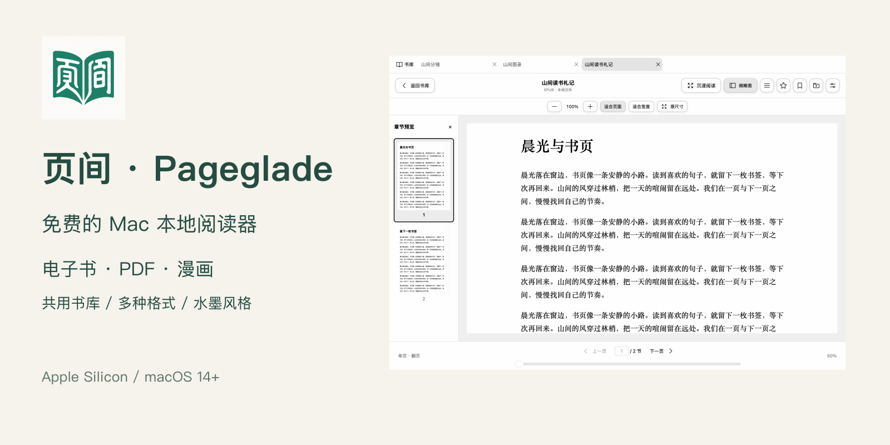

# 页间 · Pageglade

免费的 macOS 本地阅读器。电子书、PDF、漫画共用一个书库，支持多种格式与类似 Kindle 的黑白水墨阅读主题。作者 **TaylorWang**。无需注册阅读账号，书籍与记录保存在本机。

## 下载与安装

**[下载最新正式版 1.1.1](https://github.com/yuwang4321/Pageglade/releases/tag/v1.1.1)** · [安装说明](INSTALL.md) · [历史更新记录](CHANGELOG.md)

适用于 **Apple Silicon Mac（M1 及后续）与 macOS 14+**，当前没有 Intel 安装包。下载 Assets 中的 `Pageglade-1.1.1-arm64.dmg` 和 SHA-256 校验文件，退出旧版后拖入 Applications 并选择替换。不要使用自动生成的 Source code 压缩包安装应用。

当前未做 Developer ID 发布签名或 Apple 公证，也未上架 App Store。首次打开前请核对来源与校验信息，参考安装说明，无需关闭系统安全保护。

## 一个书库，持续阅读

- **统一管理**：电子书、PDF、漫画共用书库，支持封面、多标签、收藏、历史与多文件标签页。
- **多格式**：PDF、EPUB、TXT、无 DRM MOBI/AZW/AZW3/PRC，漫画压缩包和图片文件夹。
- **适合自己的显示方式**：单页/双页、翻页/滚动、文字按屏分页、缩放、字号、目录与缩略图。
- **专注阅读**：沉浸工具栏、水墨主题、古籍竖排与稳定轮换纸纹。
- **中英文界面**：中文、英文或跟随系统，书籍原文不翻译。
- **轻量整理**：未读/在读/已读状态、默认与单书阅读设置、本地数据备份。

## 摘录与摘录集

阅读工具书或文档时，保存文字、图片和想法，在独立摘录页统一回顾。想法可选填，新摘录默认沿用书籍标签，支持多标签任一/全部筛选。

摘录采用等宽瀑布流卡片，图片保持原比例，支持拖动与键盘排序。多选内容创建摘录集、加入已有集合并调整顺序；重读时可查看原文并返回集合位置。支持 **PDF、EPUB、Markdown** 导出，图片 Markdown 使用 ZIP 携带图片。

摘录与摘录集分别展示。集合保存后保持固定内容，创建时切换标签会取消不匹配的勾选，保存前再次校验。

## 局部放大镜与截图

- 工具栏或 **⌘⇧M** 开关，支持 **1.5 / 2 / 3 / 4 倍**并记住倍率。
- **⌥＋滚轮** 调整倍率，单击页面固定或继续跟随。
- **保存放大区域**：仅保存镜片内容，不含边框和按钮，保留来源位置。
- **原页圈选**：暂时隐藏镜片，保存或取消后恢复；沉浸阅读同样支持。
- PDF 局部重新渲染，图片清晰度取决于原文件分辨率。

## 1.1.1 古籍阅读优化

古籍采用默认20列、横向展开与中央鱼尾版心。放大原始藏书印、铜镜印和 Logo 白文画押，右上主印、左下两印错落成组。增加侧边留白，避免裁切和遮挡正文。每叶稳定随机出现1～3种印章，纸纹对比轻微降低。

统一使用说明整合新功能和快捷键，弹窗顶部返回与关闭按钮始终可见。

[查看完整发布说明](https://github.com/yuwang4321/Pageglade/releases/tag/v1.1.1)

## 支持格式与限制

- 电子书与文档：PDF、EPUB、TXT、无 DRM MOBI/AZW/AZW3/PRC。
- 漫画与图片：ZIP/CBZ、RAR/CBR、7Z/CB7、图片文件夹。
- 其他：FB2；HTML、RTF、DOCX 文字读取，复杂排版可能丢失。

本地版内置 calibre，Kindle 直接解析正文、图片和封面，不转成 EPUB；FB2 本地转换。组件许可及对应源码随 DMG 提供，无需另行安装 calibre。

不支持 DRM、KFX、DJVU、CHM、AZW4，无 OCR、无云同步。扫描页没有可搜索正文，复杂或损坏文件可能有兼容性问题。水墨为软件显示主题，不承诺护眼效果。

## English

Pageglade is a free local macOS reader for ebooks, PDFs and comics. It offers a shared library, Chinese/English UI, immersive reading, monochrome styling, text/image excerpts and ordered collections with PDF/EPUB/Markdown export. Version 1.1.1 includes a local magnifier with region capture, masonry excerpt cards and refined classical-page seals. Requires Apple Silicon and macOS 14+. The DMG is not Developer ID signed or notarized. See [installation instructions](INSTALL.md) and [release notes](https://github.com/yuwang4321/Pageglade/releases/tag/v1.1.1).

## 反馈与仓库范围

欢迎通过 [Issues](https://github.com/yuwang4321/Pageglade/issues) 提交系统版本、应用版本、文件格式、复现步骤和截图。请勿公开上传未经授权的整本书籍，可使用自制最小样例。

本仓库提供介绍和发行资料，**不包含 Pageglade 应用源码**。免费使用不代表按开源许可证发布，第三方组件遵循各自许可证。应用名称 Pageglade，中文品牌「页间」，Logo 使用繁体「頁間」。
